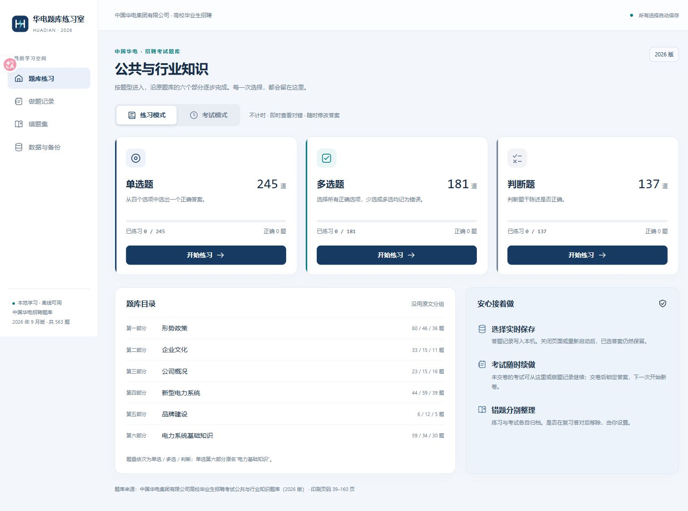

# 华电公共题库练习室

当前版本：**v1.0.3**。目前仅支持 **Windows 10/11 64 位**。

v1.0.3 加入按场景自动下一题，并为练习错题复习增加默认关闭的答案显示开关。多选题仅在普通练习中全部选对后自动跳转，在考试和两类错题复习中均手动点击“下一题”。自动跳转始终在保存成功后发生，最后一题不会自动交卷。

v1.0.2 为练习模式加入“显示整套正确答案”开关。开启后可直接查看当前题型所有题目的正确选项和参考答案，未作答题同样显示；切换题号时保持开启，重新进入练习、切换题型或刷新页面后默认关闭。查看答案不会产生作答记录，考试与错题复习规则不变。

v1.0.1 调整多选题答题卡：已选选项全部正确但未选全时为灰色，包含任何错误选项时为红色，完全正确为绿色，未作答保持空白。此规则适用于练习、错题复习及考试交卷后的回顾；考试交卷前仍以蓝色表示已答。计分与错题收录规则不变。

本地运行的中国华电高校毕业生招聘考试公共与行业知识刷题程序，支持练习、考试、历史记录和错题复习。题库为 **2026 年 9 月版，共 563 题**；使用过程中无需联网或登录，学习记录保存在本机 SQLite 数据库中。



## 下载与启动

### Windows 便携版（推荐）

1. 在 [Releases](https://github.com/NAM1B0/huadian-quiz-room/releases/latest) 下载 `huadian-quiz-room-v1.0.3-windows-x64.zip`。
2. 完整解压到可写目录，双击 **启动华电题库.cmd**。
3. 默认浏览器会自动打开。通过“数据与备份 → 保存并关闭程序”结束运行。

便携版支持 Windows 10/11 64 位，内置 Python，无需另行安装。GitHub 自动生成的 **Source code** 压缩包不包含运行环境，请按下面的源码方式运行。

### 从源码运行

安装 Python 3.12 或更新版本，在项目目录执行：

```sh
python server.py --open
```

Windows 安装 Python 后也可双击启动脚本。程序仅使用 Python 标准库，运行时不需要 `pip install` 或 Node.js；其他操作系统目前不在支持范围内。

默认地址为 `http://127.0.0.1:18926`；端口被占用时会自动选择可用端口，实际地址写入 `data/运行地址.txt`。不要直接打开 `web/index.html`。本项目需要本地 Python 服务，不能直接作为纯静态 GitHub Pages 网站使用。

## 刷题功能

| 功能 | 行为 |
| --- | --- |
| 三种题型 | 单选 245 道、多选 181 道、判断 137 道，各自保留原题号 |
| 分类答题卡 | 左侧题目和选项，右侧按原题库六个部分分组，可点题号跳转 |
| 练习模式 | 不计时，即时判分，题号绿色正确、灰色多选漏选、红色错误，可反复修改；重启后保留选择 |
| 整套答案开关 | 普通练习和练习错题复习均可显示参考答案，包含未作答题；同套换题保持，每次进入或刷新默认关闭，查看不计入作答 |
| 考试模式 | 每个分组内随机排序，保留分组顺序；累计答题时间，提交前蓝色表示已答 |
| 考试续做 | 每种题型最多一套未交卷试卷，普通入口及历史入口均可继续，题序保持不变 |
| 交卷与回顾 | 全部作答后才可交卷；交卷后显示对错并锁定答案；再次从普通入口进入创建新试卷 |
| 做题记录 | 保存练习和复习操作历史、每场考试、完成状态及用时 |
| 练习错题 | 根据正常练习最新选择更新；在正常练习里改对会移出 |
| 考试错题 | 按考试场次分别保存，后续场次答对不覆盖以前的错题 |
| 错题移出开关 | 两类错题分别设置“复习答对后自动移出”，默认关闭；错题复习不覆盖原作答 |
| 原文核对 | 练习及已交卷回顾可定位 PDF 原页；考试进行中不展示该入口 |

多选题必须完全选对才判正确。考试计时在离开或隐藏考试页面时暂停，无倒计时限制；成绩为按题数等权计算的学习统计。具体行为和数据恢复方法见 [使用说明](使用说明.txt)。

自动下一题规则：

| 场景 | 单选题、判断题 | 多选题 |
| --- | --- | --- |
| 普通练习 | 答对后自动下一题，答错留在原题 | 全部选对后自动下一题，漏选或错选留在原题 |
| 考试交卷前 | 选择并保存后自动下一题 | 手动点击“下一题” |
| 练习错题复习 | 答对后自动下一题 | 手动点击“下一题” |
| 考试错题复习 | 选择并保存后自动下一题，不要求答对 | 手动点击“下一题” |

可随时通过题号返回修改。只查看答案、清空选择或保存失败不会触发跳转；最后一题只保存并提示，交卷仍需手动确认。错题是否移出继续由独立开关控制，复习作答不覆盖原记录。

## 题库结构

题库保留：形势政策、企业文化、公司概况、新型电力系统、品牌建设、电力基础知识六部分；多选和判断的第六部分原名为“电力系统基础知识”。第六部分的小分类同样保留。

题库取自原 PDF 印刷页码 **39–160**（PDF 文件第 **40–161** 页），原题号为单选 1–245、多选 246–426、判断 427–563。校验摘要见 [report.json](tools/extraction/report.json)。

## 数据与备份

每次选择自动保存到 `data/学习记录.sqlite3`，不依赖浏览器缓存。程序不自动过期清理记录；迁移时先关闭程序，再复制整个 `data/` 目录。启动时生成当天备份，通过界面关闭时生成退出备份，也可在界面导出完整备份。

`data/`、数据库、个人备份、运行地址和缓存已加入 `.gitignore`，发布包也通过文件白名单排除这些数据。更新程序时请保留自己的 `data/`。

## 开发与验证

```sh
python tools/test_app.py
```

11 项自动验收覆盖题库完整性、历史持久化、多选判分、分组乱序、未交卷续做、交卷锁定、不同场次错题、移出开关、计时、备份和 HTTP 接口，包括整套答案完整性、查看答案不写入记录及考试答案隔离。

开发者安装 Node.js 后可运行前端验收（日常使用程序不需要 Node.js）：

```sh
node tools/test_frontend.js
```

28 项前端验收覆盖四种场景与三种题型、保存后跳转、手动多选、答案开关、错题移出、快速改选、保存失败、导航竞争和最后一题，不使用个人学习数据。

仅重新提取 PDF 时需要额外安装 `pypdf`：

```sh
python -m pip install pypdf
python tools/extract_bank.py
# 或指定同版原始 PDF：
python tools/extract_bank.py --source "/path/to/附件2_20260914225451.pdf"
```

构建 Windows 便携版（下载运行环境需要联网，刷题不需要）：

```sh
python tools/build_runtime.py
python tools/package_app.py
```

运行环境已存在时构建器会停止以免覆盖；可用 `--output` 指定新的空目录，再通过打包器的 `--runtime` 传入。构建器校验官方 SHA-256，产物默认位于 `dist/`。

```text
server.py          本地 HTTP 服务和 SQLite 数据管理
web/               原生 HTML、CSS、JavaScript 界面
bank.json          563 道题的结构化题库
source/            对照用原 PDF
tools/             提取、校验、测试、构建脚本
docs/              界面截图
data/              运行后生成，个人数据，不上传
runtime/           便携版运行环境，不纳入源码 Git 历史
```

## 许可证

原创程序代码采用 [MIT License](LICENSE)。原始 PDF、题库文字和第三方运行环境不在该授权范围内，详见 [第三方内容说明](THIRD_PARTY_NOTICES.md)。本项目为个人学习工具，与中国华电集团有限公司不存在官方隶属或背书关系。
