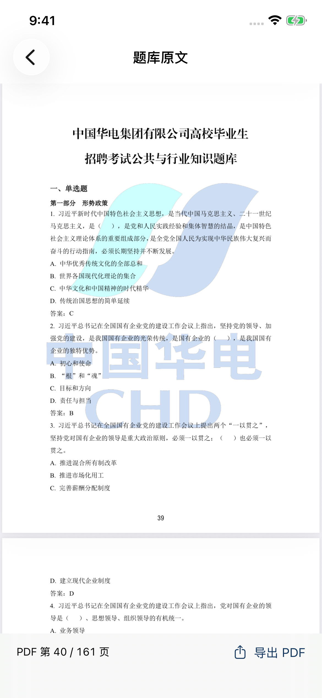
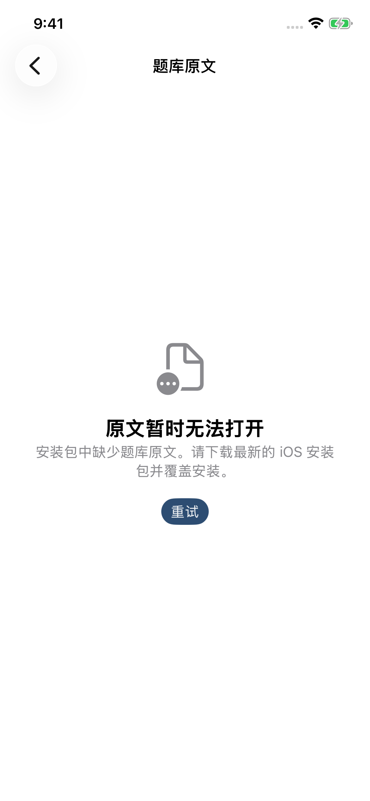

# iOS 原文阅读修复验证记录

日期：2026-10-29。应用版本 **1.0.4**，构建号 **10402**，最低 iOS 26.0。

## 构建来源

发布 IPA 由[真机归档工作流](https://github.com/NAM1B0/huadian-quiz-room/actions/runs/40891912299)生成，归档提交为 `0f1bc45132abe6214813e001c0d68c92456d541e`。使用 GitHub macOS runner、Xcode 26.6（17F113）、iOS SDK 26.5，归档 arm64 真机应用。

手机测试提交为 `8e6afc34299f0f70d194651eab4d2f2150694785`。已比较两次提交中的应用源码、题库、资源、项目配置和打包脚本，内容相同；其间只有测试和 CI 调整。手机环境为 iPhone 13 Pro / iOS 26.5 模拟器。

[已完成的测试运行](https://github.com/NAM1B0/huadian-quiz-room/actions/runs/40892339455)：**14 项单元测试、6 项原生 UI 测试通过**。原文综合 UI 测试在短滑动后的页码断言处失败，未执行到后续题目入口；该断言的手势已修正，补充回归见[运行记录](https://github.com/NAM1B0/huadian-quiz-room/actions/runs/40895305673)。发布时补充回归仍在运行，不将其计为已通过。

**实体手机确认：**用户安装了与本次发布 SHA-256 相同的构建 10402，在本对话中确认“数据 → 题库原文”已正常显示并可上下滚动。该确认只覆盖这条原文入口及滚动，不代表所有功能均在真机逐项验证。

## 核验内容

- 161 页 PDF 可以解析和绘制，渲染位图非空白，题库页文本可读取。
- 阅读器在有实际屏幕尺寸后初始化，定位 PDF 第 95 页，旋转后仍有可见页面。
- 数据入口从 PDF 第 40 页（原文印刷页码 39）开始，原生截图已人工确认正文可见；实体手机已确认显示和滚动。
- 缺失或损坏的 PDF 有可操作的错误提示；界面可以重试和返回。
- 同时回归已有的练习保存、自动下一题、考试锁定、记录删除、备份导入、大字体和深色模式。

之前的界面测试把一次短滑动后“页码未变”直接视为失败。PDF 连续滚动时，同一页可以仍处于可见区域；最终测试改为在阅读区域执行至多三次明确的拖动，仍要求页码发生变化。页面起点 40 和题目定位 95 的断言保持不变。

补充界面回归还将完整检查：连续滚动跨页、横屏显示、从题目 245 跳到 PDF 第 95 页后返回题目。请以所链接的运行结果判断这条完整路径的自动化状态。

## 原生模拟器截图

以下截图来自上述已下载核对的测试运行，应用源码与发布 IPA 相同。错误页是测试故意模拟缺少 PDF 的结果。

| 数据页打开原文 | 模拟资源缺失 |
| --- | --- |
|  |  |

## 安装包检查

文件：`huadian-quiz-room-v1.0.4-ios26-build10402.ipa`，**1,627,912 字节**。

SHA-256：`b31cfca9c9b6ee33dc29727e842351cf09f48b656f69ce0e0fbdcbd47d9a698f`

包内 PDF：`Payload/HuadianQuiz.app/question-bank.pdf`。

PDF SHA-256：`6e489808b82b2269cffa89d9fcf338a5930b2c22df3641bc44777412fad0f2ce`

本地与构建流程均检查 ZIP CRC、ASCII 路径、Info.plist、arm64 Mach-O 的 iOS 真机平台标识、最低系统 26.0、可执行权限、563 道题和 18 个分组、隐私清单及原 PDF 的逐字节一致性。不包含个人学习记录或测试框架。

```sh
python3 ios/tools/verify_ipa.py path/to/huadian-quiz-room-v1.0.4-ios26-build10402.ipa --build 10402
```

## 验证边界与更新

本次自动验证基于模拟器；实体 iPhone 经侧载工具重新签名后的原文显示和滚动已获用户确认。其余功能的真机覆盖范围、VoiceOver 人工体验和长期使用尚未逐项验证。Windows v1.0.4 与学习记录格式未改动。

更新前在“数据 → 导出学习记录”保存备份，再使用原签名账号和 App ID 覆盖安装。安装后在“数据 → 版本”核对 `1.0.4 (10402)`。
