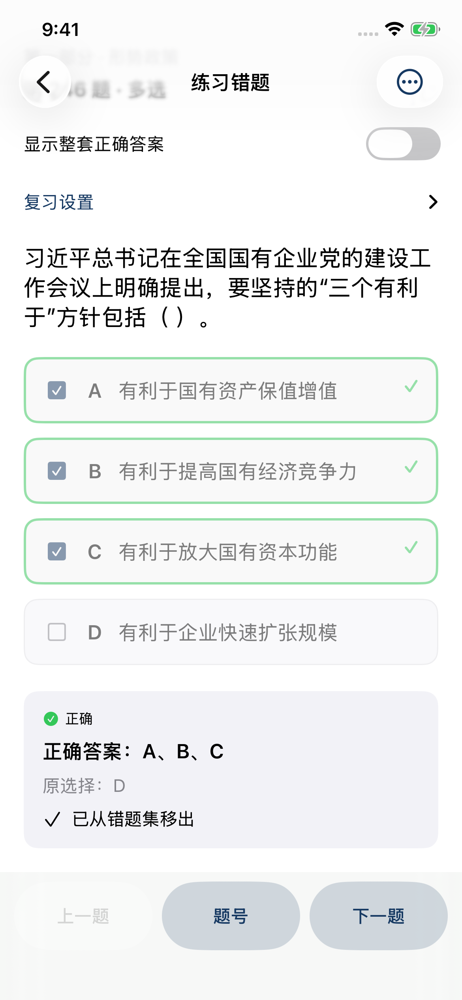
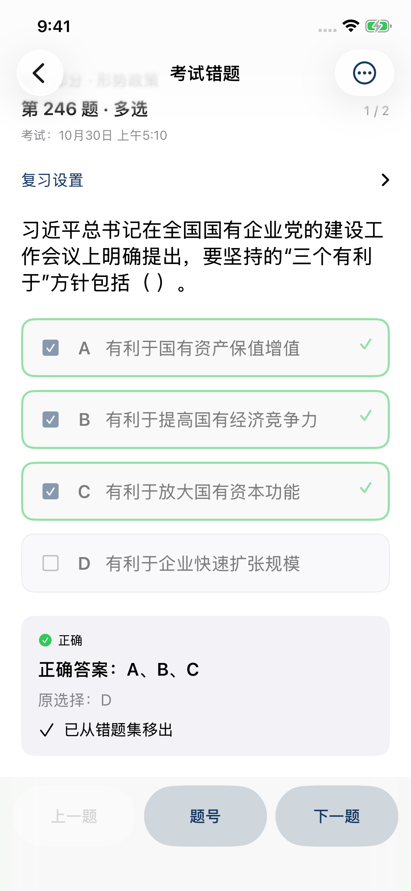

# iOS 判分与错题复习修复验证

2026-10-30。应用版本 **1.0.4**，内部构建 **10403**，最低 iOS 26.0。

## 构建与测试来源

IPA 由[定向补测及归档工作流](https://github.com/NAM1B0/huadian-quiz-room/actions/runs/41006056416)生成，提交 `f7b3e669262ebc77e329a5f9aa484c2dddea2466`，使用 iOS SDK 26.5，目标为 arm64 真机应用。

**18 项单元测试、10 项原生 UI 场景通过，分两轮验证。** [完整回归](https://github.com/NAM1B0/huadian-quiz-room/actions/runs/41003480997)在提交 `3bb7d056d43af5fc64407df7725006b56a252774` 上通过全部 18 项单元测试和 9 项 UI 场景；剩余多选错题场景失败，因为测试点击了开关所在行的标签位置，录像显示开关没有开启。修改测试为点击右侧开关本体、先断言开关已开启后，补测再次通过全部 18 项单元测试及该项 UI 场景（同时覆盖两类错题）。

已通过 Git 比较确认两轮之间的应用源码、资源、项目配置、题库和打包脚本完全一致；更改仅限测试与 CI。定向补测不是完整 UI 重跑，以上 10 项覆盖是两轮结果合计。测试设备均为 iPhone 13 Pro 模拟器。

## 核验范围

- 普通练习多选先保存草稿，全选正确时自动检查并下一题；否则第一次下一题检查并停留，第二次翻题。
- 两类错题多选即使全选正确，也在点击下一题后才检查；自动移出开关只在检查正确后生效。
- 两类错题的单选、判断答错停留、答对自动下一题；正式考试原有规则保留。
- 修改后重新待检查、重启保存草稿、最后一题检查、旧 JSON 兼容、Windows SQLite 中未检查选择的导入、失败写入不改记录。
- 原文显示和滚动、题目定位原文、缺失资源提示、考试交卷锁定、记录管理、答案预览重置、深色模式、大字体和横屏回归。

## 原生截图

截图已人工查看，显示检查后停留本题和检查正确后移出提示。

| 练习错题 | 考试错题 |
| --- | --- |
|  |  |

[普通练习多选检查后显示漏选并停留](../docs/ios/10403/practice-multiple-checked.png)。

## 安装包核验

文件 `huadian-quiz-room-v1.0.4-ios26-build10403.ipa`，**1,632,580 字节**。

SHA-256：`9f7ab252fd66ed53d73eb3e01fc088c82e4c5382c94ace680b6ebc9f1ce923e7`

本地和云端均检查了 ZIP CRC、ASCII 路径、版本 1.0.4 / 10403、最低系统 26.0、arm64 Mach-O 真机平台标识、可执行权限、563 题和 18 个分组、隐私清单及 PDF 逐字节一致性。不包含学习记录或测试框架。

包内 PDF SHA-256：`6e489808b82b2269cffa89d9fcf338a5930b2c22df3641bc44777412fad0f2ce`。

```sh
python3 ios/tools/verify_ipa.py path/to/huadian-quiz-room-v1.0.4-ios26-build10403.ipa --build 10403
```

## 验证边界与更新

构建 10403 尚未在实体 iPhone 上重新侧载并逐项验证。之前用户对构建 10402 原文显示的真机确认不作为新构建的真机测试结果。

更新前导出学习记录，使用原签名账号和 App ID 覆盖安装；不要先卸载旧版。安装后在“数据 → 版本”核对 `1.0.4 (10403)`。
