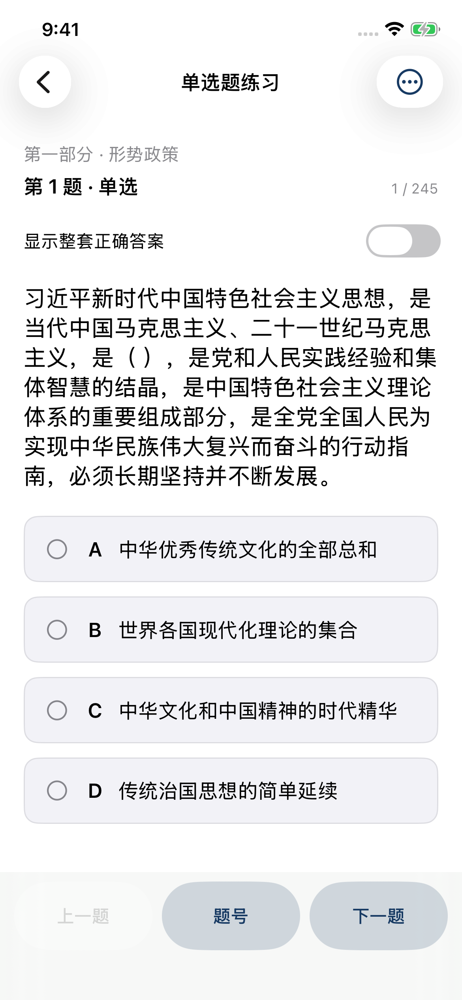
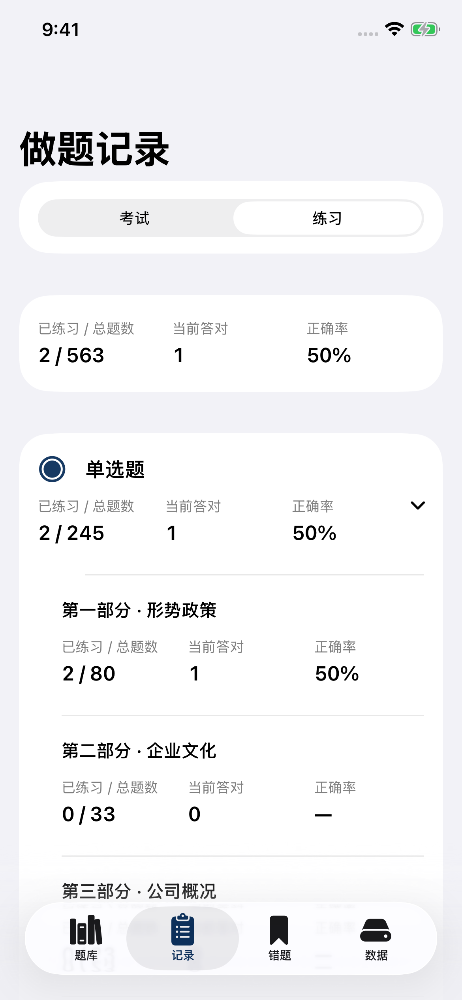
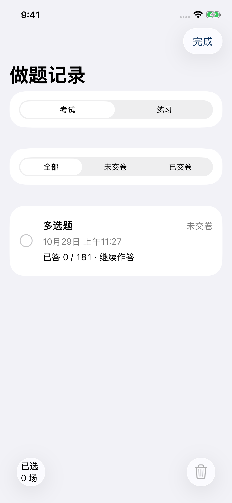
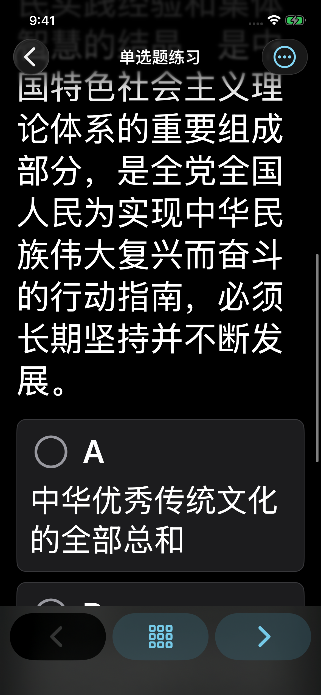

# iOS v1.0.4 验证记录

日期：2026-10-29。应用版本 1.0.4，构建号 10401，最低 iOS 26.0。

原生应用源码提交：`79c1dba58ae9299db3d675eec97e21a9c296afd9`。使用 GitHub macOS runner、Xcode 26.6（17F113）、iOS SDK 26.5；在 iPhone 13 Pro / iOS 26.5 模拟器执行测试，随后归档 arm64 真机应用。

[成功的构建与测试](https://github.com/NAM1B0/huadian-quiz-room/actions/runs/40864052937)：**11 项单元测试、5 项原生 UI 测试，全部通过**。

## 已验证

- 563 道题、18 个分组；多选漏选与错选判定；各场景自动下一题规则。
- 最新练习答案、分组统计、重启续做；两类错题与原作答相互独立。
- 考试按部分内打乱、续做、不完整试卷禁止交卷、交卷后锁定、新考试保留旧错题。
- 删除指定考试前备份，保留其他考试和练习；写入或备份失败时不修改内存状态。
- JSON 恢复校验、Windows SQLite 导入、时间累计边界。
- 手机界面中正确单选自动下一题、考试多选手动下一题、默认关闭答案开关、答案重启后保留。
- 记录编辑与删除、练习汇总、交卷锁定、从入口创建新考试。
- iPhone 13 Pro 的竖屏、横屏、深色模式与辅助功能大字体。检查了原生截图中的选项换行、底部操作、分组题号和记录页面。

## 安装包检查

发布文件：`huadian-quiz-room-v1.0.4-ios26.ipa`，1,617,536 字节。

SHA-256：`509148c65ebbd1b52eed7a8cf09d106de0008d80577579d57eb2ff5fdd361f84`

本地检查了 ZIP CRC、Info.plist、Mach-O arm64 可执行文件及 iOS 真机平台标识、最低系统版本、可执行权限、题库及 PDF 资源；不包含用户数据库、测试记录或 XCTest 框架。发布前修正了 ZIP 容器的中文资源名 UTF-8 标记，全部 11 个归档条目的内容哈希与原 Xcode 产物一致。应用源代码与二进制未因此改变，后续 CI 打包脚本也采用标准 UTF-8 ZIP 写入。

此 IPA 需要 AltStore Classic / AltServer 等工具重新签名。**尚未进行实体 iPhone 的侧载测试、VoiceOver 人工实测或长期电池测试**；模拟器验证不能替代这些检查。

## 原生模拟器截图

以下均来自本次通过的原生 UI 测试。

| 答题 | 练习记录 |
| --- | --- |
|  |  |

| 编辑考试记录 | 深色模式及大字体 |
| --- | --- |
|  |  |
